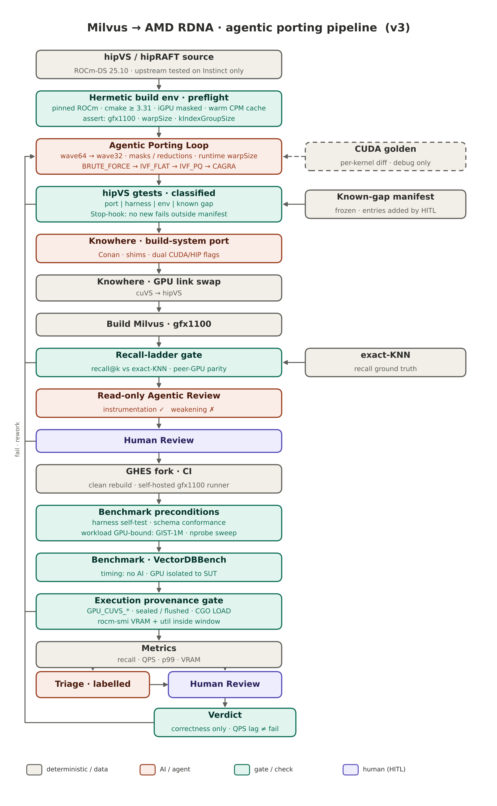

## 6. How we ported it

A HIP port is not a rewrite of the kernels for RDNA3. We did not retune the GPU kernels for RDNA3. We kept the NVIDIA algorithms and ran them through HIP. We touched the compute path only when search was wrong, not when it was merely slow.

Two parts of the team did the port. The stack was the same. The method was not.

### 6.1 Using a coding assistant

We brought the stack up one layer at a time. Skip a layer and the next one can pass for the wrong reason.

| Layer | What we needed | Pass |
|-------|----------------|------|
| 0 | ROCm 7.0.2 and CPU Milvus on Ubuntu 22.04.5 | `gfx1100` visible; Standalone answered |
| 1 | hipRAFT / hipVS | Build; neighbour tests |
| 1.5 | IVF packer on this GPU | Float IVF tests 98/98 after `kIndexGroupSize=32` |
| 2 | Knowhere linked to hipVS | GPU L2 (Euclidean) search tests green |
| 3 | Milvus from source | `GPU_IVF_*` build / load / search |
| 4 | Fair benches | Same recall gate as CUDA |

One part of the team sat in the IDE with a coding assistant, edited C++, ran the gates, and decided which numbers could leave the lab. The packer fix and the nightly plots in this article come from that line.

GPU search already worked. Recall on that path was 1.0, and the neighbour lists were right. The red result was the internal layout check `testPacker`. The mask was computed for groups of 32, while the data was packed in groups of 64 — Instinct's wavefront. The check expected 13 and read 26, exactly twice the count. The suite then showed 97/98 failed, with the neighbours still correct: a false failure on the packer. This `gfx1100` path needs groups of 32, like an NVIDIA warp. We set `kIndexGroupSize = 32` and `USE_WARPSIZE_32`. After that, the float IVF tests passed 98/98.

Knowhere did not need new GPU algorithms. We rebuilt it so it links hipVS instead of cuVS. We reworked the CMake files so HIP would link.

### 6.2 Using a pipeline of agents

Another part of the team ran a closed agent pipeline: adapt hipVS and hipRAFT, build Knowhere, run tests. Almost no hand-written C++. The loop was not asked to rewrite kernels for RDNA3. The pipeline is built on the layer ladder above: L0, then L1, L2, L3, and L4. Each layer has a gate, and the run moves on only after that gate passes. In that pipeline L0 is the host and provisioning. The IVF packer check sits inside L1.

The gates themselves are deterministic scripts; no person and no model decides pass or fail. What a rule table cannot settle — is this failure flaky, which defect first, is another iteration worth it — goes either to a person (the default) or, with an `--autonomous` switch, to an AI verifier, and every such answer is logged. Decisions that would change what counts as success — quarantining a failure, raising a budget, signing off — stay with a person in both modes.

That pipeline is not on public GitHub yet. On CI run 588103 the two AMD ports ran in turn, six repeats each, and agreed within ±2% of the spread. Its dashboard still needs a rerun, so those CI repeats are not the lines in the plots below.

Grey is an ordinary build or data step. Orange is the agent. Green is a gate. Purple is a person.
