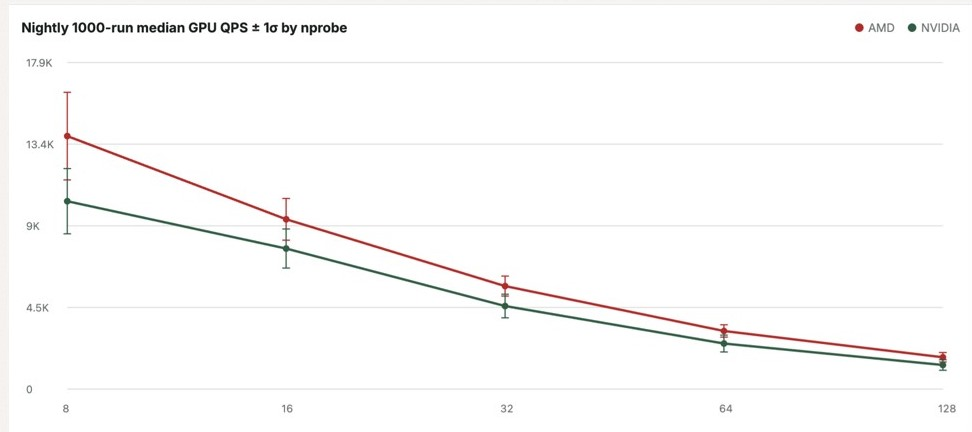
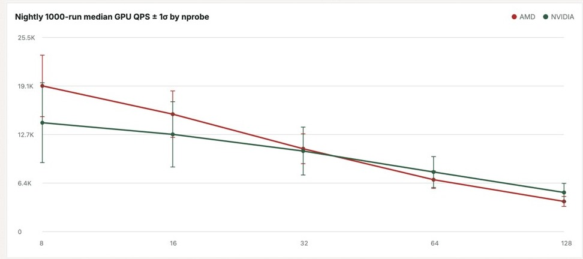

## 9. Results

The two figures are the nightly run on GIST-1M. Each point is the median of 1,000 sweeps that passed the recall gate. Red is the Radeon RX 7900 XTX. Green is the GeForce RTX 4080. The horizontal axis is nprobe, from 8 to 128. The vertical axis is queries per second.

### Uncompressed: `GPU_IVF_FLAT`

`GPU_IVF_FLAT` keeps full-precision vectors inside each cluster. On this chart the 7900 XTX is above the 4080 at every nprobe. Both lines fall as nprobe grows. Each query scans more clusters, so the GPU does more work per query.

The size of that lead depends on the summary. At nprobe 8 it is about **+15–30%**. The single figure **+26%** is the high end of that range. At nprobe 128 the summaries agree near **1.3×**.

### Compressed: `GPU_IVF_PQ`

`GPU_IVF_PQ` stores a short code for each vector. The median lines meet near nprobe 32. At nprobe 8 the median is about **+36%** on the 7900 XTX. At nprobe 128 it is about **−22%**. As a ratio, that is about 1.36× down to 0.78×.

That median can mix two modes. On a CI run of this harness, IVF_PQ queries per second formed two modes about 1.7× apart. The AMD median sat in the fast mode. The NVIDIA median sat in the slow mode. Inside one mode, the 7900 XTX is about **0.87×** the 4080 at low nprobe and about **0.65×** at high nprobe. The same-mode curves do not cross. The harness still plots the median, which is the crossing on the figure.

Recall@10 on the recipes we checked matches the NVIDIA build: 0.9910, 0.9918, and 0.9909.

| Index | Nightly median | Same mode |
|-------|----------------|-----------|
| `GPU_IVF_FLAT` | 7900 XTX ahead at every nprobe | About +15–30% at nprobe 8; about 1.3× at nprobe 128 |
| `GPU_IVF_PQ` | +36% at nprobe 8; lines meet near nprobe 32; −22% at nprobe 128 | About 0.87× to 0.65×; the 4080 is ahead |

Read the FLAT chart as the uncompressed result. The 7900 XTX is faster at every nprobe. Read the PQ chart as a median. The crossing is what that median draws. The same-mode ratios keep each card in one mode.

The whiskers are one standard deviation across the thousand sweeps. On a bimodal PQ sample that spread is not one cloud. Warmup is about 100 runs, and those early samples pull the median down. A one-shot harness table can disagree with these lines. The figures are the nightly medians.
